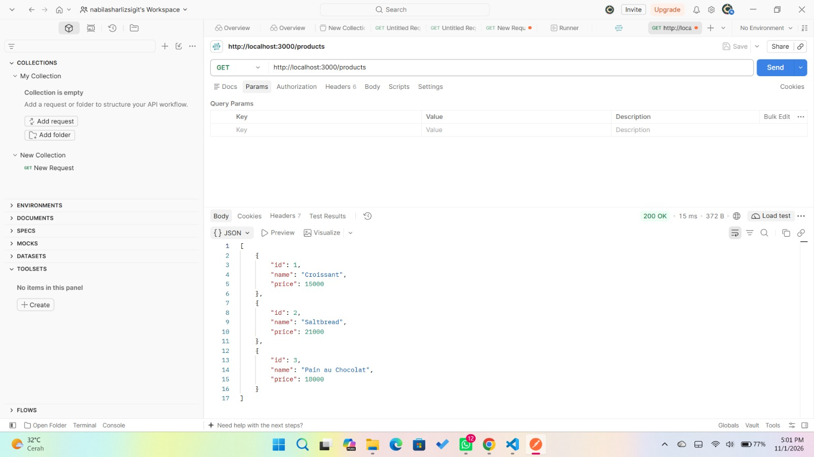
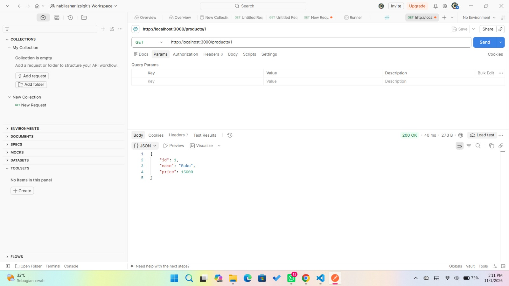
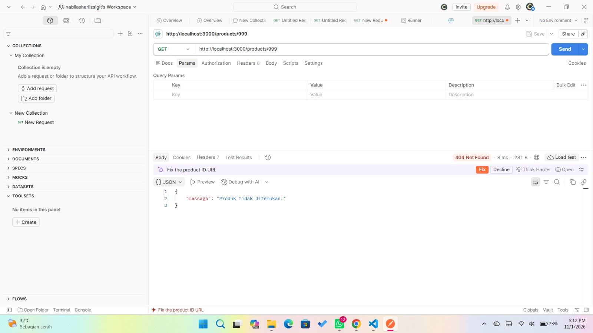
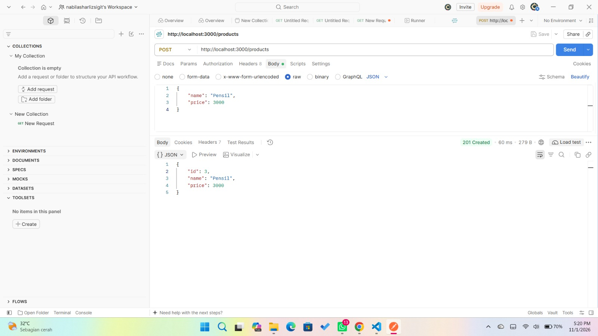
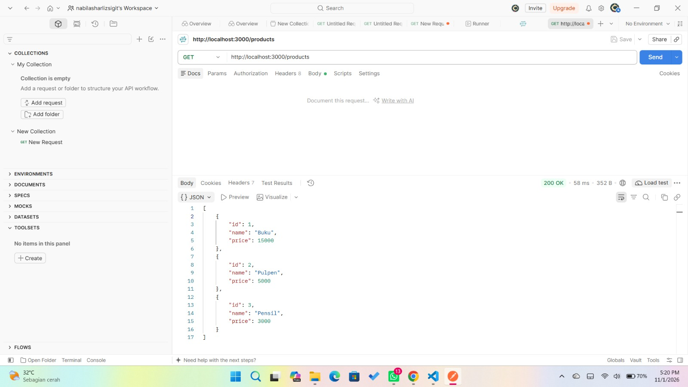

# Tugas Pemweb Express JS dan Database - API Daftar Produk

Nama : Nabila Sharliz Sigit
NRP : 5027251054
Mata Kuliah : Pemograman Web - C

## Teknologi yang digunakan:
- Node.js
- Express.js
- Postman

## Cara menjalankan Project

1. Install dependencies:

```
npm install
```

2. Jalankan server:

```
npm start
```

3. Server berjalan pada:

```
http://localhost:3000
```

## Daftar Endpoint API

1. GET -> /products = Mengambil seluruh data produk

2. GET -> /products/:id = Mengambil produk berdasarkan ID

3. POST -> /products = Menginputkan atau memasukkan data produk baru

## Contoh Penggunaan API pada Postman

1. GET semua produk
Request: GET
URL: http://localhost:3000/products
Response: 200 OK



2. GET produk by ID
Request: GET
URL: http://localhost:3000/products/:id
Response : 200 OK
Error : 404 Not Found
(Jika ID produk tidak ditemukan)





3. POST tambah produk
Request: POST
URL: http://localhost:3000/products
Body -> raw -> isi data produk yang ingin ditambah (name, price)

```
{
    "name": "Pensil",
    "price": 2000
}
```
Response : 201 Created



---
## Final Data Produk 



Tambahan tugas express-database koneksi dengan Neon

1. POST


